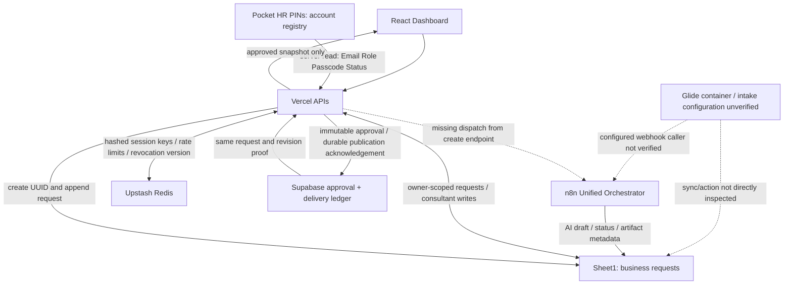

# Pocket HR — Production remediation နှင့် integration audit

စစ်ဆေးသည့်ရက်: 2026-10-15 UTC။ Repository: `riddler9999/panellistmm`, PR #13,
branch `feat/pocket-hr-embed-dashboard`။ **ပြီးစီးပြီဟု မသတ်မှတ်ရသေး။**
လက်ရှိ source၊ live Google Sheets၊ n8n active version၊ Supabase schema နှင့် Vercel logs ကို အသုံးပြုထားသည်။
Glide builder နှင့် Google Cloud administration access မရှိသဖြင့် ထိုနေရာများကို verified ဟု မဆိုထားပါ။

## A. Login root cause နှင့် ပြင်ဆင်မှု

1. မူလ Production deployment `dpl_7k86yFhDiJzKzN6NFtz8b7ra94qf` သည် `4006652701ddcb29ad61e7bdb99c9ad009118abf` ကို serve လုပ်နေသည်။
   `2026-10-15T18:58:49.566Z` log တွင် `sheet_accounts / sheet_token_unavailable` ဖြစ်သည်။
2. Production `GOOGLE_SERVICE_ACCOUNT_EMAIL`, `POCKET_HR_SHEET_ID`, `SUPABASE_URL` တို့ကို
   Vercel က decrypt လုပ်ပြီးနောက်လည်း encrypted envelope တစ်ခု ထပ်ကျန်နေသည်။ Actual email၊ ID၊ URL မဟုတ်ပါ။
   Preview counterparts ကို decrypt လုပ်၍ shape စစ်ပြီး Sheet ID ကို live workbook/n8n mapping၊
   service-account email ကို Drive permission၊ Supabase project ကို live database နှင့် တိုက်စစ်ခဲ့သည်။
   Production values သုံးခုကို မှန်ကန်သော values ဖြင့် ပြင်ပြီး read-back equality စစ်ခဲ့သည်။
3. Configuration-only redeploy `dpl_5cQkZpfCstRpiXKXFkct75xnKuyv` နောက်ပိုင်း OAuth အောင်မြင်ပြီး
   failure သည် `pin_sheet_unavailable` သို့ပြောင်းသွားသည်။ Private key signing နှင့် OAuth token exchange အလုပ်လုပ်ကြောင်း သက်သေဖြစ်သည်။
4. Safe diagnostic commit `59555445b688bfedeeda8b937d0b73430001e10a`၊ deployment
   `dpl_FBy3nMdXp3gFPjNf5cQyxooah9Ew` တွင် `2026-10-15T19:16:03.247Z` log က
   **HTTP 403, PERMISSION_DENIED, SERVICE_DISABLED** ဟု အတည်ပြုသည်။
   `tiktok-mini-shop` project တွင် Google Sheets API enable လုပ်ရန် ကျန်နေသည်။
   Credential ပြောင်းခြင်း၊ auth bypass သို့ public Sheet read fallback ဖြင့် မဖုံးကွယ်ထားပါ။
5. Source limiter ဖြတ်ပြီး OAuth/Sheets အထိ ရောက်သောကြောင့် Upstash limiter requests အလုပ်လုပ်သည်။
   Session creation/retrieval အောင်မြင်ကြောင်း မဆိုနိုင်သေး။

| Environment variable | Production | Preview | စစ်ဆေးမှု |
|---|---|---|---|
| UPSTASH_REDIS_REST_URL | ရှိ | ရှိ | Runtime source limit ဖြတ်နိုင် |
| UPSTASH_REDIS_REST_TOKEN | Sensitive ရှိ | Sensitive ရှိ | Value မထုတ်ပြ၊ limiter အလုပ်လုပ် |
| GOOGLE_SERVICE_ACCOUNT_EMAIL | ပြင်ပြီး | ရှိ | Production decrypt read-back မှန် |
| GOOGLE_SERVICE_ACCOUNT_PRIVATE_KEY | Sensitive ရှိ | Sensitive ရှိ | OAuth exchange အောင်မြင်၊ value မဖတ်/မထုတ်ပြ |
| POCKET_HR_SHEET_ID | ပြင်ပြီး | ရှိ | Live workbook နှင့် active n8n documentId တူ |
| SUPABASE_URL | ပြင်ပြီး | ရှိ | Existing Panellist project |
| SUPABASE_SERVICE_ROLE_KEY | Sensitive ရှိ | Sensitive ရှိ | Server-side approval transport live test မပြီး |

### အရေးပေါ် access finding

Drive permissions တွင် workbook အတွက် `anyone:reader` ရှိသည်။ Unauthenticated CSV request ဖြင့်
`Pocket HR PINs` headers နှင့် account row တစ်ခုကို HTTP 200 ဖြင့်ဖတ်နိုင်ကြောင်း စမ်းပြီးဖြစ်သည်။
PIN values ကို report/log/git တွင် မထည့်ထားပါ။ General access ကို **Restricted** ပြောင်းရန်၊
ထို့နောက် existing PIN ကို rotate လုပ်၍ sessions invalidate လုပ်ရန်လိုသည်။
Service account သည် reader သာဖြစ်သောကြောင့် request/approval/PIN writes အတွက် Editor လိုသည်။
လက်ရှိ connector တွင် public permission removal tool မရှိ၊ Google Cloud admin tool မရှိ၍ owner-side steps ကို တောင်းထားသည်။

## B. Actual data ownership နှင့် flow

- PIN ကို Vercel က Sheets မှ unique active account တစ်ခုနှင့် match လုပ်သည်။ Role/owner email ကို browser input မှ မယူပါ။
- Redis တွင် random session token hash၊ account email၊ revocation version၊ 30-day TTL ရှိသည်။
  Cookie: `HttpOnly; Secure; SameSite=None`။ Session retrieval တိုင်း account status/role နှင့် version ပြန်စစ်သည်။
  Logout က Redis session delete လုပ်သည်။ Actual Glide third-party-cookie persistence ကို မစမ်းရသေး။
- Business owner သည် `Owner_Email` ဖြစ်သည်။ Owner မရှိသော row ကို User ထံ မပို့ပါ။
  React creation က verified session email နှင့် UUID ကို သုံးသည်။ Glide identity capture/Row Owners ကို မစစ်နိုင်သေး။
- n8n `request_id` ကို Sheet `Row ID` နှင့် match လုပ်သည်။ `🔒 Row ID` နှင့် မတူပါ။ Live rows 60 တွင် တစ်ခုမျှ တူမနေပါ။
- Consultant edit/clarify/reject သည် Vercel APIs → Sheet writes ဖြစ်သည်။ Approval သည် Supabase RPC →
  Sheet Delivery Pending → Final_Answer → delivery acknowledgement → Sheet Approved ဖြစ်သည်။
- Delivery acknowledgement သည် durable dashboard publication ဖြစ်ပြီး email ပို့ပြီးကြောင်း သို့ user ဖတ်ပြီးကြောင်း သက်သေမဟုတ်ပါ။
- Supabase approval RPC တွင် request-level advisory lock၊ revision conflict နှင့် identical retry idempotency ရှိသည်။
  Tables တွင် RLS enabled၊ RPC execute သည် service_role/postgres သာဖြစ်သည်။
- Supabase တွင် approval 0၊ delivery 0။ Sheet တွင် Approved 22 ရှိသော်လည်း release proof မဟုတ်ပါ။
  ပြင်ထားသော User API သည် matching approval/delivery proof မရှိလျှင် answer မပို့ပါ။
- Sheet row lookup နှင့် write ကြား concurrent row movement အတွက် atomic transaction မရှိသေး။
  Approval ledger atomicity ကို Sheets writes ၏ atomicity ဟု မယူဆရ။

## C. Google Sheets column audit

Workbook: `Panellist HR Tickets Bridge` (`1B6Mo7NU6E1erFosckf8KZv1sz2SZeSJdVwq7BhS1-qQ`)။
`Sheet1!A1:AH1004` FORMULA read တွင် data rows 60၊ columns 34၊ duplicate Row ID 0၊ missing Owner_Email 9 ဖြစ်သည်။
Read range တွင် formulas မတွေ့။ Counts သည် populated-cell counts ဖြစ်ပြီး usage proof တစ်ခုတည်း မဟုတ်ပါ။
`V` = current Vercel source၊ `N` = inspected n8n active graph၊ `G?` = Glide dependency မစစ်နိုင်သေး။
Required `မသေချာ` သည် consumer မရှိဟု မဆိုလိုပါ။ Recommendation များကို live deletion အဖြစ် မလုပ်ထားပါ။

| Column | Current Purpose / populated rows | Read/Write Owner | Required? | Recommendation |
|---|---|---|---|---|
| Row ID | Request identity / 60 | V R/W; N lookup | Yes | Keep — canonical integration key |
| Ticket_Title | Dashboard title / 53 | V R/W; G? | Yes | Keep |
| Ticket_Status | Lifecycle / 53 | V R/W; N R/W | Yes | Keep — shared state contract လို |
| Ticket_Category | Category / 51 | V R/W; G? | Yes | Keep |
| Request_Text | Request body / 53 | V R/W; G? | Yes | Keep |
| AI_Answer | Internal draft / 52 | N W; V Admin R | Yes | Keep — User မပို့ရ |
| Consultant_Answer | Consultant edits / 20 | V R/W; N guard R | Yes | Keep |
| Final_Answer | Published Sheet mirror / 21 | V W; N guard R | Yes | Keep — ledger proof မဟုတ် |
| Created_At | Creation time / 53 | V R/W; G? | Yes | Keep |
| Subject | Legacy/intake title / 2 | G?; N webhook `subject` | မသေချာ | Merge → Ticket_Title, Glide mapping စစ်ပြီးမှ |
| HR Issue | Intake issue / 1 | G?; N webhook `hr_issue` | မသေချာ | Merge → category/body, meaning မပျောက်စေရ |
| Description | Intake description / 1 | G?; N webhook `description` | မသေချာ | Merge → Request_Text after consumer audit |
| File | Attachment intake / 0 | G?; N webhook attachments | မသေချာ | Keep pending attachment/action dependency check |
| Unified_Status | Older routing state / 17 | G?; current N Sheet writer မရေး | မသေချာ | Deprecated candidate; do not infer Ticket_Status equivalence |
| Requested_Capabilities | Routing result / 12 | N response; Sheet consumer G? | မသေချာ | Keep pending Glide mapping check |
| Needs_Clarification | Clarify flag / 17 | V W; N response only | Yes | Keep — N Sheet mapping gap ရှိ |
| Clarification_Question | Clarify prompt / 1 | V Admin R/W; N response only | Yes | Keep — approved User question flow မပြီး |
| Artifact_Type | Artifact kind / 10 | V Admin R; G? | Yes | Keep pending artifact contract reconciliation |
| Artifact_File_Name | File label / 11 | G?; current N writer မရေး | မသေချာ | Merge candidate with Artifact_Title; names differနိုင် |
| Artifact_Download_URL | Direct download / 13 | N W; G? | Yes | Keep — editor URL နှင့် မပေါင်းရ |
| Artifact_Editor_URL | Editable diagram / 18 | N W; G? | Yes | Keep |
| Unified_Reason_Code | Routing diagnostic / 17 | N response; Sheet consumer G? | မသေချာ | Keep internal pending dependency check |
| Sheet_AI_Answer | Legacy draft alias / 6 | V fallback R; G? | မသေချာ | Merge candidate → AI_Answer; populated values မတူ |
| AI_Draft | Older draft / 11 | current V/N Sheet writer မသုံး; G? | မသေချာ | Deprecated candidate; AI_Answer နှင့် populated values မတူ |
| Review_Status | Consultant review / 38 | V R/W; N guard R | Yes | Keep |
| Processing_Status | Processing state / 11 | V Admin R; G? | Yes currently | Keep pending reconciliation with lifecycle |
| Artifact_Title | Display title / 29 | N W; V Admin R | Yes | Keep |
| Artifact_URL | General artifact entry / 26 | N W; G? | Yes currently | Keep until Glide link usage known |
| Artifact_Format | Format / 5 | V Admin R; G? | Yes currently | Keep |
| Artifact_Status | Artifact review state / 32 | N W; V Admin R | Yes | Keep |
| Processing_Error | Error diagnostic / 0 | current V/N Sheet writer မသုံး; G? | မသေချာ | Candidate for Removal only after workflow/action check |
| Owner_Email | Request owner / 51 | V R/W; G? | Yes | Keep — 9 ownerless rows need evidence-based reconciliation |
| Admin_Role | Legacy role marker / 60 | V auth မသုံး; G? | မသေချာ | Deprecated for auth; retain until Glide Row Owners check |
| 🔒 Row ID | Glide-native identity / 60 | G?; V create currently W | Yes pending | Keep separate from integration Row ID; do not rename |

`Sheet_AI_Answer` 6 populated rows၊ `AI_Draft` 11 populated rows တွင် `AI_Answer` နှင့် exact equality 0 ဖြစ်သည်။
၎င်းတို့ကို duplicate ဟု အမည်အရယူပြီး ဖျက်၍မရ။ Schema snapshot JSON သည် headers-only ဖြစ်ပြီး data backup မဟုတ်ပါ။

| Worksheet / actual columns | Purpose / owner | Required? | Recommendation |
|---|---|---|---|
| Pocket HR PINs / Email | V identity + owner mapping | Yes | Keep; unique normalized email |
| Pocket HR PINs / Role | V authorization | Yes | Keep; Admin/User only |
| Pocket HR PINs / Passcode | V PIN login and admin writes | Yes | Keep private; text format preserves leading zeros; rotate exposed PIN |
| Pocket HR PINs / Status | V active/disabled checks | Yes | Keep |
| App: Metadata / Last Automatic Refresh Initiated | Glide refresh metadata; actual writer not directly inspected | မသေချာ | Keep |
| App: Metadata / Last Manual Refresh Requested | Glide refresh metadata; actual writer not directly inspected | မသေချာ | Keep |
| App: Logins / Time | Glide login audit metadata | မသေချာ | Keep; V auth မသုံး |
| App: Logins / Email | Glide login audit metadata | မသေချာ | Keep; identity proof မဟုတ် |
| App: Logins / Agreed | Consent audit metadata | မသေချာ | Keep |
| Backup Sheet1 pre-dedup 2026-09-23 / 33 columns | Hidden historic snapshot; Sheet1 first 33 headers နှင့်တူ | မသေချာ | Keep archival; active V/N reader မတွေ့ |

Rename recommendation ကို လက်ရှိ consumer evidence မပြည့်သဖြင့် အတည်မပြုထားပါ။
မည်သည့် live column/data ကိုမျှ မဖျက်၊ မပြောင်း၊ မရွှေ့ထားပါ။ Destructive migration မလုပ်သဖြင့် full data backup မဖန်တီးထားပါ။
နောက် migration မလုပ်မီ private full workbook backup၊ formulas/validation၊ Glide screens/actions/relations၊
n8n active/draft consumers၊ existing record conflict resolution နှင့် explicit deletion approval လိုသည်။

## D. Glide audit limitation နှင့် minimum schema proposal

Glide connector/builder access မရှိ။ Actual Ticket Data Table basic/computed/relation/lookup/user-specific/hidden columns ကို
စာရင်းပြည့်အဖြစ် မထင်မှတ်ထားပါ။ Synced Sheet headers ကို Glide complete schema ဟု မဆိုထားပါ။
Glide URL နှင့် supported browser/device ကို owner ထံမေးထားသည်။

အနည်းဆုံး viable schema အဆိုပြုချက်: Glide-native immutable row ID၊ integration Request ID၊
verified owner binding၊ title/category/request body/created time၊ attachment input နှင့် synchronized lifecycle display။
AI drafts၊ approval proof၊ delivery proof၊ PIN registry ကို user-downloaded table ထဲ သီးခြား state အဖြစ် မထပ်ထားသင့်ပါ။
Relations/lookups သည် active screens/actions ကိုထောက်ပံ့လျှင် keep လုပ်ရမည်။
Owner capture၊ Row Owners၊ native ID ↔ Request ID mapping၊ webhook request/response binding၊
embedded URL၊ logout/cookie behavior မစစ်မီ မည်သည့် Glide field ကိုမျှ ဖယ်ရှား၍မရ။

## E. n8n live audit

| Workflow ID | Verified role/state | Findings |
|---|---|---|
| 97Hrjp3aKOLIR4wJ | Unified Orchestrator, active | Webhook intake, routing, AI/artifact calls, Sheet bridge writes |
| kZVxvax5MG7BIClj | HR Consultant Internal API, active | Validate context → agent with retry → normalized result; Sheet side effects မရှိ |
| tyGUPkBhNvx3C4wv | Artifact Architect API, active listing | Artifact specialist; full internals မစစ်ထား |
| yQVgbyhG3wITYTLN | Attachment Processor, active listing | Attachment extraction; full internals မစစ်ထား |
| UFve7ksYST5vCaar | Recovery Executor, active | Fail-closed gate/read-only inspection; recovery writes မလုပ် |

Orchestrator active version `1af405cf-b035-442e-80a7-240744e538af` နှင့် draft
`912b66dc-c3e8-4ea4-85ae-acbb5881d02d` မတူ။ Audit သည် active graph ကို သီးခြားဖတ်ထားသည်။

- POST `panellist-unified` webhook တွင် configured authentication မရှိ။ Request ID ကို caller ပို့သည်။
  Allowed payload တွင် `request_id, company_id, user_id, subject, hr_issue, description, attachments, submitted_at, source` ပါသည်။
  `Owner_Email` ကို မသတ်မှတ်၊ `user_id` ကို verified identity ဟု မယူနိုင်။ Authenticated intake contract မပြီးသေး။
- New React request သည် Sheet append သာလုပ်ပြီး webhook မခေါ်။ Active orchestrator သည် Sheet trigger မဟုတ်ပါ။
  Historical poller ရှိကြောင်း doc ကို current active automation အဖြစ် မယူရ။
- Active Sheet writer သည် Row ID ဖြင့် update လုပ်၍ AI_Answer, Ticket_Status,
  Artifact_Title, Artifact_URL, Artifact_Status, Artifact_Download_URL, Artifact_Editor_URL ကို ရေးသည်။
  Consultant_Answer/Final_Answer ကို မ overwrite လုပ်ပါ။ Human-answer/final-state guard ရှိသည်။
- Clarification response တွင် flag/question ရှိသော်လည်း active bridge writer mapping တွင် မပါ။
  Clarification ကို AI_Answer တွင်ထားပြီး Awaiting Review သတ်မှတ်သည်။ Approved User clarification/reply loop မပြီးသေး။
- Sheet row synchronization အတွက် lookup retries 3 ကြိမ်ရှိသည်။ နောက်ဆုံး lookup miss branch တွင် error output မချိတ်ထား။
  Response ကို Sheet write မပြီးမီ ပို့သည်။ Caller success သည် persisted result success မဟုတ်ပါ။
- Guard သည် expensive AI calls နောက်မှ လုပ်သည်။ Duplicate webhook request တွင် repeated AI processing ကို မတားနိုင်။
  Read-then-write guard သည် concurrent consultant write နှင့် atomic မဟုတ်ပါ။
- Dedicated Pocket HR approval/delivery/clarification workflows ကို search မတွေ့။ Current approval/delivery owner သည် Vercel + Supabase ဖြစ်သည်။
- Retry nodes ကို redundant ဟုမဖယ်ထား။ Active/draft မတူသည့် workflow ကို ပေါင်း publish မလုပ်ထား။
  Nodes removed/simplified: **0**။ Live workflow execution ကို trigger မလုပ်ထား၍ AI credential health PASS ဟု မဆိုထား။

## F. Targeted fixes နှင့် simplification decisions

| Existing implementation | Verified problem | Replacement / action | Integration impact / migration | Risk / verification |
|---|---|---|---|---|
| Double-encrypted Production configuration | OAuth issuer၊ Sheet ID၊ DB URL မမှန် | Correct values, decrypt read-back | No schema change; redeploy လို | OAuth advances; Sheets SERVICE_DISABLED remains |
| Generic Sheets failure | exact upstream reason မမြင်ရ | status + allowlisted machine codes only | Public response unchanged | Secret-redaction regression test |
| Sheet status-only User release | approval/delivery ledger bypass | reuse existing releasedAnswer policy + batch proofs | Existing unproved answers withheld; no fake backfill | missing/stale/pending/success tests |
| Account-ID-only approval reader | current RPC writes approved_by_email | support current email approver and legacy UUID proof | No new registry/table | live schema verified; policy tests |
| Escaped email/PIN regex | valid account creation/reset rejected | correct regex | Existing API unchanged | leading-zero PIN / malformed input / role tests |
| Approval endpoint accepts Resolved | read-only lifecycle bypass | reject before ledger or Sheet writes | No migration | regression verifies no writes |
| Multiple draft/status columns | values differ; Glide dependencies unknown | retain, dependency-gated merge proposal | Migration deferred | full consumer audit + private backup needed |
| React append without n8n dispatch | request stops after persistence | proposed authenticated dispatch using existing n8n/Redis | Caller/ownership/dedup contract must be verified | Not implemented; end-to-end blocker |

New databases/services/auth providers/queues: **0**။ Existing React UI မပြောင်း။
No destructive Sheets/Glide mutation၊ no Supabase migration၊ no workflow activation ပြုလုပ်ထားပါ။

## Verification ledger

| Check | Actual result |
|---|---|
| Baseline unit tests | 28 files / 96 tests passed |
| Final targeted suite before final release | 31 files / 110 tests passed |
| Typecheck / lint / production build | passed after fixes |
| Original lint invocation | failed on latest ESLint preserve-caught-error rule; explicit redaction rationale added and rerun passed |
| npm ci | failed: repository has no lockfile; npm install used; failure not hidden |
| Local Playwright existing viewer | 375/390/414/768/1280 widths, approved/denied mocked API, artifact URL checks passed |
| Real production mobile Admin login | active PIN → HTTP 503 Login unavailable, no horizontal overflow |
| Production forged email/role/bearer | curl probe → 403 access_denied |
| Playwright APIRequest direct forged probe | ECONNREFUSED from runner; curl retry above passed |
| Invalid / duplicate / disabled PIN | unit/integration mocks passed; valid-shaped invalid PIN live → 503 while Sheets unavailable |
| Admin / User role and cross-user isolation | automated mocked tests passed; actual User accounts absent (registry has one active Admin only) |
| Session retrieval / logout invalidation | mocked integration tests passed; live session cannot be created yet |
| Glide embed persistence | NOT EXECUTED; builder/browser target missing |
| Production request → assessment → approval → delivery | NOT PASSED; Sheets API, write permission, intake dispatch and Glide gaps remain |

## Remaining owner/access steps

1. Enable Sheets API in `tiktok-mini-shop` and rerun live login. Google Cloud admin access is absent here.
2. Restrict workbook sharing, then rotate exposed PIN and invalidate sessions. Give service account required write permission.
3. Inspect Glide builder bindings/Row Owners and authorize non-sensitive User A/User B test accounts for live isolation/UAT.
4. Complete authenticated n8n dispatch, dedup and clarification round-trip against the actual Glide actions; do not blindly publish existing draft.
5. Review historical Approved rows individually; no approval/delivery evidence must be fabricated or inferred from status.

Production is **not fully remediated** until those checks pass. Release evidence is appended after final deployment verification.
